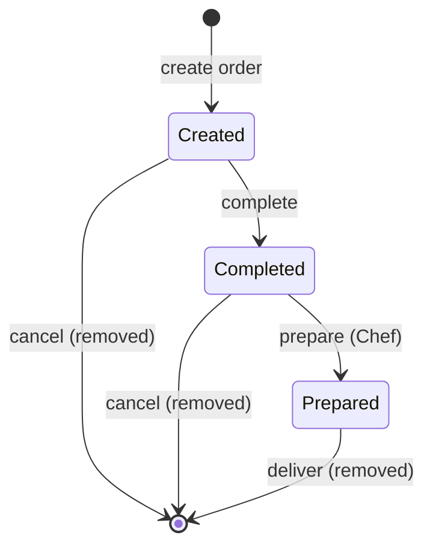

# Pancake Lab

## Description
Our Coding Dojo uses Pancake Lab, a pancake shop software solution for ordering pancakes.
The software solution can be used to order pancakes to the disciples' rooms and also
by the Sensei's Chef and Delivery service to prepare and deliver the pancakes.

### Use case
1. In the first step the Disciple creates an Order and specifies the building and the room number.
2. After that the Disciple can add pancakes from the menu.
3. The Disciple can choose to complete or cancel the Order, if cancelled the Order is removed from the database.
4. If the Disciple completes the Order the Chef can prepare the pancakes.
5. After the Chef prepares the Order it can be delivered.
6. After the Order is sent for delivery it is removed from the database.

## Problem statement
At first all was well but soon Disciples started to demand various kinds of pancakes that the application
didn't support or anyone could ever imagine.
The evil Dr. Fu Man Chu, the main Villain fighting the Sensei in an endless confrontation, took the chance
to bring havoc against his hated Dojo.
He hacked the system to add mustard with milk-chocolate and whipped cream pancake.
Some errors were also reported, disciples reported that pancakes were missing, delivery reported that they were
sent to a building that does not exist, etc.

## Assignment
The Sensei proposed that the application should be refactored. You, his best Disciple, have been tasked
to save the pancakes production in the Dojo.

The Sensei has put forth some conditions:
- the solution should be based on Object-oriented programming
- TDD should be followed
- the solution and the client API should be based on pure Java only, without usage of any frameworks and/or external dependencies
- the API should not expose any internal domain objects to its callers
- the solution should avoid hardcoded recipes
- disciples should not use builders to create pancakes and pass them to the API, they should be able to add ingredient after ingredient to the pancake through the API
- input data should be validated
- possible data-race issues should also be addressed
- documentation in the form of UML diagrams would be beneficial


Start now your assignment and save the Dojo.


## Design decisions
The assignment leaves some points open. The following decisions were taken before starting the refactoring:

| Topic                   | Decision                                                                                                                                                                                                                                                                                                      |
|-------------------------|---------------------------------------------------------------------------------------------------------------------------------------------------------------------------------------------------------------------------------------------------------------------------------------------------------------|
| Buildings and rooms     | The registry of known buildings is supplied by the API client when creating the service, so buildings can change without recompiling the library. Orders are accepted only for registered buildings; any other building is rejected. There is no registry of rooms: room numbers only need to be positive.    |
| Cancelling an order     | The Disciple can cancel an Order while creating it and also after completing it, as long as the Chef has not prepared it yet.                                                                                                                                                                                 |
| Menu                    | The menu is supplied by the API client when creating the service, so ingredients can change without recompiling the library. The Dojo's menu contains exactly these ingredients: dark chocolate, milk chocolate, whipped cream and hazelnuts. Mustard, and any other ingredient not on the menu, is rejected. |
| Ingredient combinations | Ingredients from the menu can be combined freely, e.g. a pancake with both dark chocolate and milk chocolate. The same ingredient cannot be added twice to the same pancake.                                                                                                                                  |
| Plain pancakes          | A pancake without any ingredient is valid.                                                                                                                                                                                                                                                                    |
| API                     | The public API stays close to the current `PancakeService` signatures, changing only where the Sensei's conditions require it (e.g. not exposing domain objects and adding pancakes ingredient by ingredient).                                                                                                |
| Pancake identification  | Each pancake gets an id when added. Ingredients are added and pancakes removed by that id, and viewing an order shows each pancake's id and description. Removal by description and count was dropped: more robust, though further from the original `PancakeService` signatures, as the assignment allows.   |

### Order lifecycle



## Building and testing

Requirements:
- Java 17
- Maven 3.9.0 or newer

Run the tests:

```shell
mvn test
```

Compile, test, and package all at once:

```shell
mvn package
```
