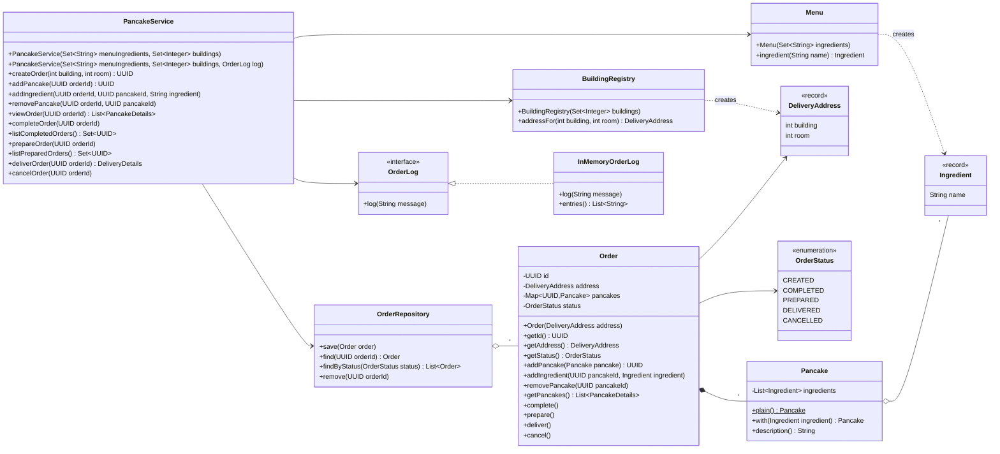
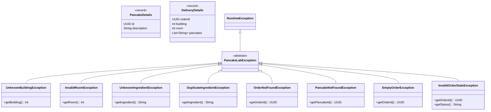
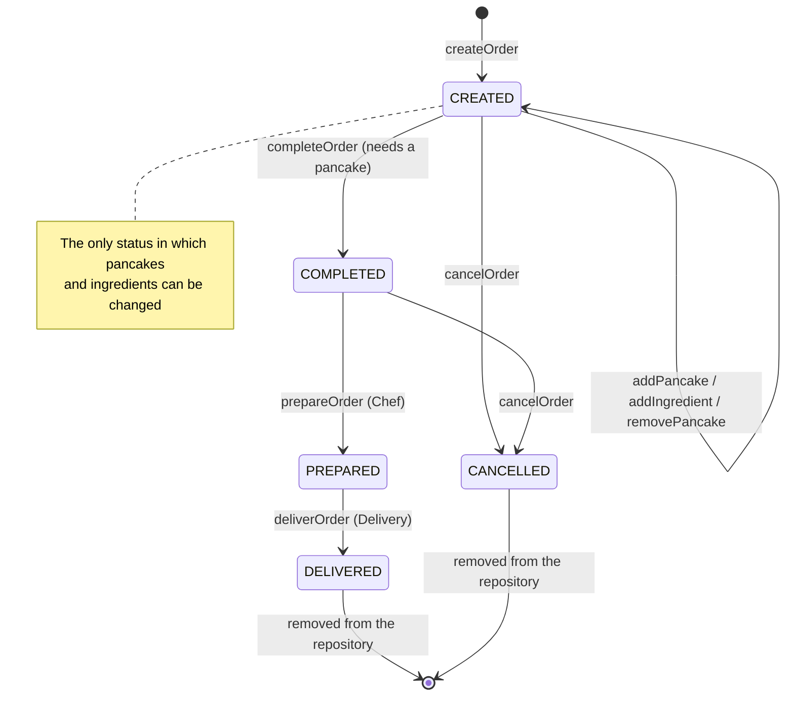
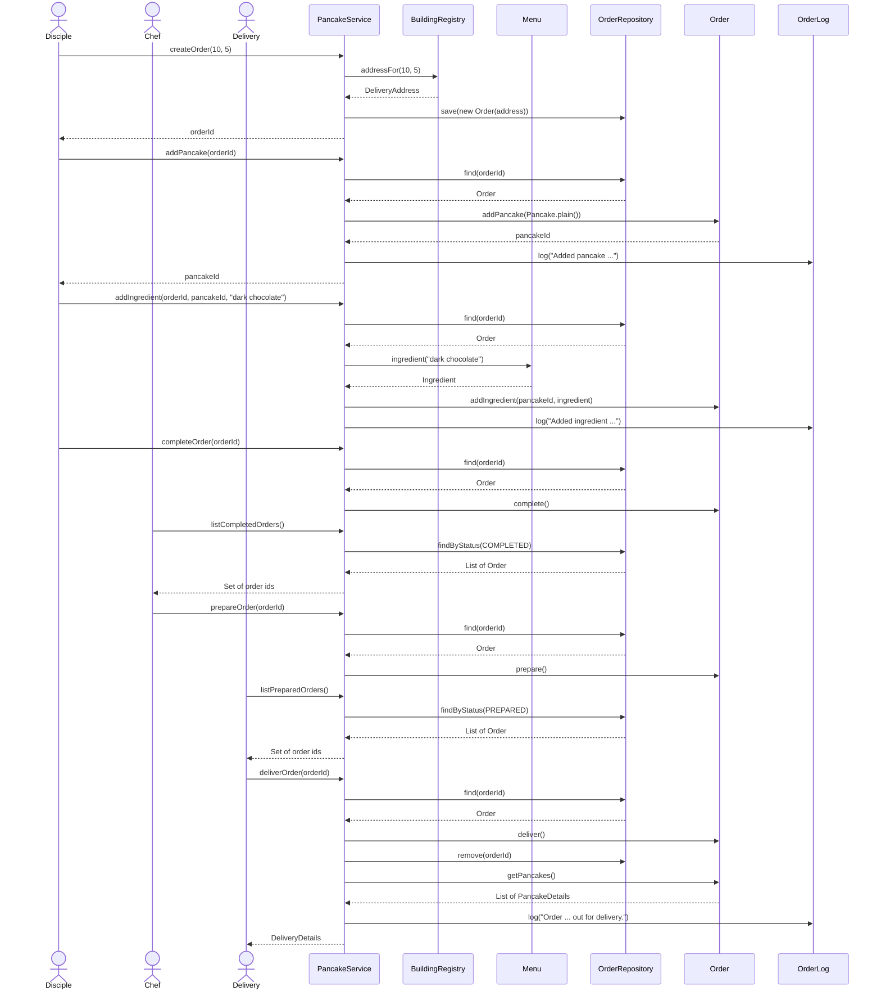
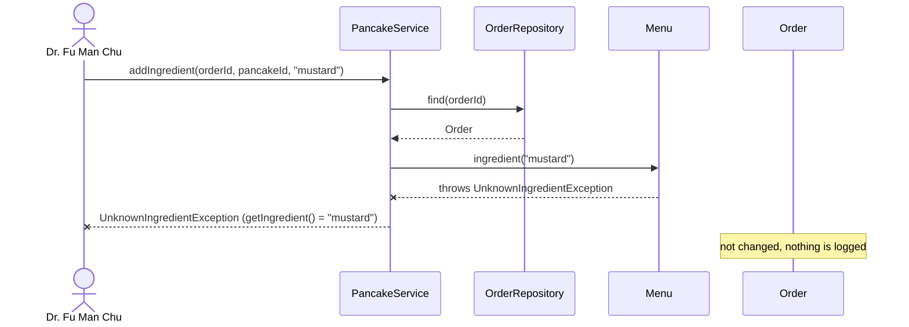
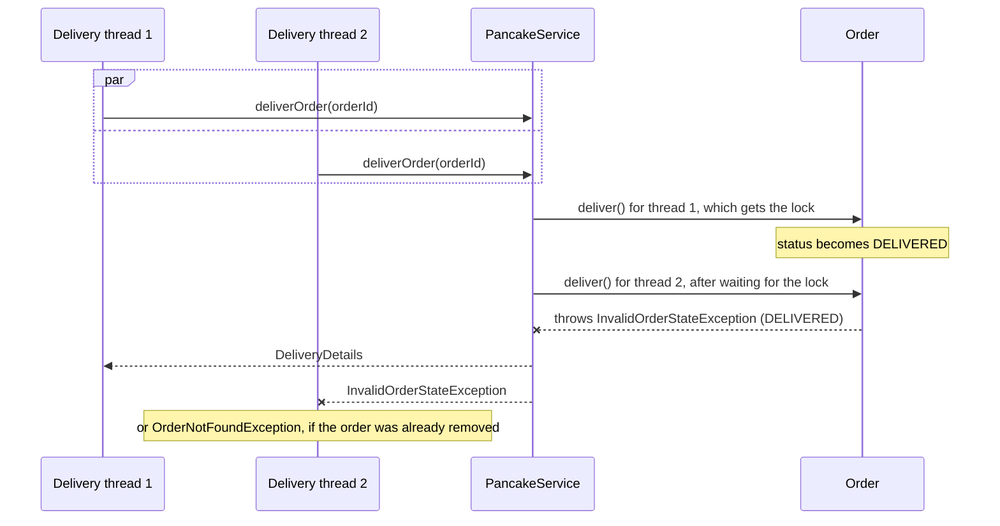

# UML diagrams

The diagrams below are written in [Mermaid](https://mermaid.js.org/), so they live as text next to the code and are
rendered by GitHub and by the IntelliJ Markdown preview (Mermaid support may need to be enabled in
*Settings → Languages & Frameworks → Markdown*).

1. [Class diagram](#1-class-diagram)
2. [DTOs and exceptions](#2-dtos-and-exceptions)
3. [Order lifecycle](#3-order-lifecycle)
4. [Sequence: ordering, preparing and delivering pancakes](#4-sequence-ordering-preparing-and-delivering-pancakes)
5. [Sequence: rejected operation](#5-sequence-rejected-operation)
6. [Sequence: concurrent deliveries](#6-sequence-concurrent-deliveries)

## 1. Class diagram

`PancakeService` is the public API. It only coordinates: it looks orders up in the `OrderRepository`, delegates the
rules to the domain (`model` package) and returns ids and immutable records, never domain objects.

- **Composition** (`*--`): an order owns its pancakes, which do not exist outside it. Each pancake is identified inside
  the order by the id returned from `addPancake`.
- **Aggregation** (`o--`): the repository stores orders, and a pancake refers to ingredients that exist on their own.
- **Dependency** (`..>`): `Menu` and `BuildingRegistry` validate the client's input and create the value objects.
- The menu ingredients and the registered buildings are supplied by the API client through the `PancakeService`
  constructor, so nothing about the Dojo is hard-coded in the library.
- **Thread safety**:
  - `Order`: every method that reads or changes its pancakes or status is `synchronized`.
  - `Pancake`: immutable; `with()` returns a new pancake.
  - `OrderRepository`: backed by a `ConcurrentHashMap`; `remove()` checks and removes atomically.
  - `InMemoryOrderLog`: backed by a `CopyOnWriteArrayList`; `entries()` returns an immutable copy.

## 2. DTOs and exceptions

The API only returns ids and the immutable records below. Validation and business-rule failures are reported with
unchecked exceptions that share the abstract `PancakeLabException` base class and expose the rejected value.

| Exception                      | Thrown by                       | When                                                     |
|--------------------------------|---------------------------------|----------------------------------------------------------|
| `UnknownBuildingException`     | `BuildingRegistry`              | the building is not registered                           |
| `InvalidRoomException`         | `DeliveryAddress`               | the room number is not positive                          |
| `UnknownIngredientException`   | `Menu`                          | the ingredient is not on the menu, including `null`      |
| `DuplicateIngredientException` | `Pancake`                       | the ingredient is already on the pancake                 |
| `OrderNotFoundException`       | `OrderRepository`               | the order id is unknown or `null`                        |
| `PancakeNotFoundException`     | `Order`                         | the pancake id is unknown or `null`                      |
| `EmptyOrderException`          | `Order`                         | completing an order without pancakes                     |
| `InvalidOrderStateException`   | `Order`                         | the operation is not allowed in the current order status |

## 3. Order lifecycle

Transitions are strict: any operation attempted from a status that does not allow it, including repeating the
operation that led to the current status, throws `InvalidOrderStateException`.

## 4. Sequence: ordering, preparing and delivering pancakes

The main use case of the assignment, with the Disciple, the Chef and the Delivery service.

Cancelling follows the same pattern as delivering: `find`, then `cancel()` on the order, then `remove` and `log`. The
order is removed only after the state transition succeeds, so a rejected cancellation or delivery keeps the order.

## 5. Sequence: rejected operation

Every validation happens before the order is changed, so a rejected operation leaves the order untouched and logs
nothing.

## 6. Sequence: concurrent deliveries

Two delivery threads try to deliver the same prepared order at the same time. The order lock makes the status check
and change a single step, and the atomic removal in the repository is a second line of defence, so only one delivery
succeeds.

